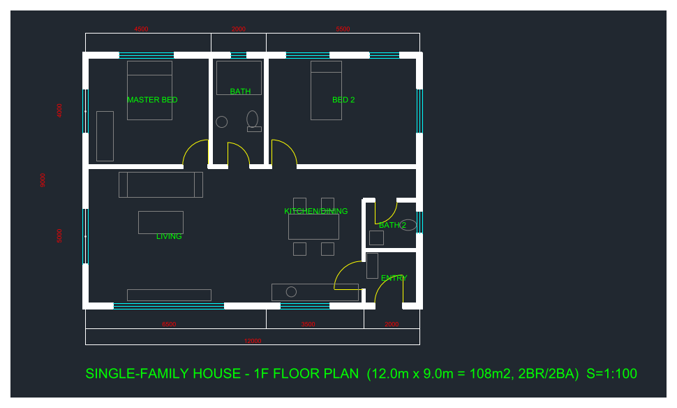

# House floor plan example

`draw_house.py` starts the AutoCAD MCP server over stdio (the same way an MCP client does) and draws a
single-family house ground floor plan using only MCP tool calls (`drawing`, `layer`, `entity`,
`annotation`, `view`).

- 12.0 m x 9.0 m (108 m²), 2 bedrooms / 2 bathrooms, millimetre units
- Walls with openings (solid hatch), windows, door swings, furniture, room labels, dimensions
- Layers: `A-WALL`, `A-WIND`, `A-DOOR`, `A-FURN`, `A-TEXT`, `A-DIM`



## Run

From the repository root:

```powershell
.venv\Scripts\python.exe examples\house_plan\draw_house.py --backend ezdxf
```

- `--backend ezdxf` — headless, no AutoCAD required (this produced the files in this folder)
- `--backend file_ipc` — draws in a running AutoCAD / AutoCAD LT 2024+ with `mcp_dispatch.lsp` loaded
- `--out DIR` — output folder for `house_plan.dxf` / `house_plan.png` (default: this folder)

## Notes (ezdxf backend)

- Dimension text uses the default 2.5 height, which is invisible at mm scale, so dimension values are
  also written as plain text on layer `A-DIM`.
- `view zoom_extents` is not supported and is reported as the single expected error.
- `entity create_ellipse` takes the major-axis **end point** (`major_x`, `major_y`), not a length.
